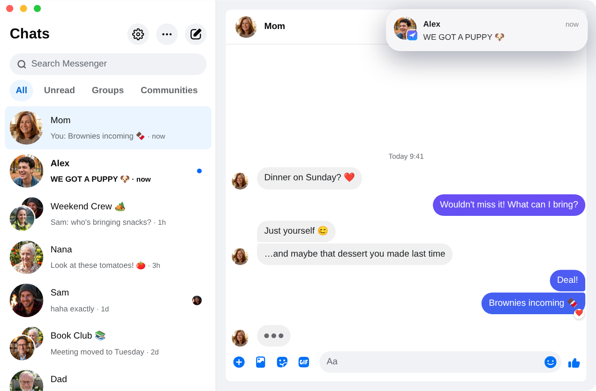

<p align="center">
  
</p>

<h1 align="center">Chatpane for Messenger</h1>

<p align="center">
  <strong>Facebook Messenger without the Facebook clutter.</strong><br>
  A free, open-source desktop app for macOS, Windows, and Linux, in 30 languages.
</p>

<p align="center">
  <a href="https://github.com/kristofferR/Chatpane/releases/latest"></a>
  <a href="https://github.com/kristofferR/Chatpane/actions/workflows/ci.yml"></a>
  <a href="LICENSE"></a>
</p>

<p align="center">
  <a href="https://chatpane.app/">
    
  </a>
</p>

<h2 align="center">Download</h2>

<table align="center">
  <tr>
    <td align="center" width="220">
      <a href="https://github.com/kristofferR/Chatpane/releases/download/v3.1.0/Chatpane_3.1.0_mac_arm.dmg">
        <br>
        <strong>Download for macOS</strong><br>
        <sub>Apple Silicon &middot; .dmg</sub>
      </a>
    </td>
    <td align="center" width="220">
      <a href="https://github.com/kristofferR/Chatpane/releases/download/v3.1.0/Chatpane_3.1.0_win_x64_setup.exe">
        <br>
        <strong>Download for Windows</strong><br>
        <sub>64-bit installer &middot; .exe</sub>
      </a>
    </td>
    <td align="center" width="220">
      <a href="https://github.com/kristofferR/Chatpane/releases/download/v3.1.0/Chatpane_3.1.0_lin_x64.AppImage">
        <br>
        <strong>Download for Linux</strong><br>
        <sub>AppImage &middot; x64</sub>
      </a>
    </td>
  </tr>
</table>

<p align="center">
  <sub>
    Intel Mac, Windows ARM, Linux ARM, portable Windows, <code>.deb</code>, or <code>.rpm</code>?
    <a href="https://github.com/kristofferR/Chatpane/releases/latest">See every download →</a>
  </sub>
</p>

<p align="center">
  <code>brew install --cask kristofferR/tap/chatpane</code>
</p>

---

Meta discontinued its Messenger desktop apps, then retired the standalone
`messenger.com` experience. Chatpane brings the focused desktop experience back:
it opens `facebook.com/messages` in a dedicated window and removes Facebook's
Feed, Reels, Marketplace, global search, and other surrounding chrome.

Chatpane uses the operating system's WebView through
[Tauri](https://tauri.app), rather than shipping another copy of Chromium. The
macOS and Windows installers are about **3–4.5 MB**, while still providing
native notifications you can reply from, unread badges, tray integration,
global shortcuts, and cryptographically verified updates.

## Why Chatpane?

- **Only Messenger**: Facebook's Feed, Reels, Marketplace and other pages are hidden.
- **Reply from notifications**: reply, react, mark as read or mute without opening Chatpane.
- **Right-click menus**: react to, reply to, forward or pin a message; mute,
  archive or mark a conversation as read.
- **Hide that you're typing**: the people you chat with don't see "typing…".
- **In your language**: menus, notifications and Settings in 30 languages.
- **Themes and app icons**: nine built-in themes or your own, an accent color,
  a message font and four app icons.
- **Your notification sound**: the system's own sounds or a file of your own.
- **Export conversations**: save a conversation as an HTML or JSON file.
- **[Schedule messages](docs/scheduled-sending.md)**: send texts at a chosen
  date and time. Chatpane must be running and connected.
- **Small**: one system WebView instead of a bundled browser engine.

## Features

### Notifications

- Native notifications with the sender's photo, and the group's picture for group chats
- Reply, react, mark as read or mute from the notification
- On macOS, message notifications show the sender's face, like Messages
- Pause notifications for an hour, until tomorrow morning, or until you turn
  them back on, from the tray or Dock menu; they also wait while a call window is open
- Messenger's own Do Not Disturb is honored, including when you turn it on from your phone
- Group-chat messages can count on the unread badge without notifying
- Muted conversations can be left out, shown on the badge only, or counted like any other chat
- No notifications for messages that are old or already read on another device, for example after sleep
- Choose the notification sound: the system default, the operating system's own
  sounds, or a sound file of your own, with a preview
- One sound per message: Messenger's in-page sounds don't double up with Chatpane's,
  and stay silent during Do Not Disturb, Pause and Mute (calls still ring)
- Hidden message previews, and a test notification in Settings that explains
  when the system is blocking banners

### Desktop integration

- Unread count on the Dock or taskbar icon, or just a dot
- Recent conversations in the Dock, tray and jump-list menus
- Tray support, start to tray, and hide on close
- Start at login that shows the real state, even when you switch it off in the
  operating system; on macOS 13 and later it's a normal Open at Login item
- Optional system-wide <kbd>Cmd/Ctrl</kbd>+<kbd>Shift</kbd>+<kbd>M</kbd> hotkey
- Menu-bar-only mode on macOS
- On macOS the window buttons sit over the chat list; on Windows and Linux
  Chatpane draws its own window buttons instead of a title bar. Under a tiling
  window manager they appear only on floating windows
- Always on top and experimental multi-window support
- Window size, position and pane widths restored between launches

### Appearance

- Themes: Default, OLED Black, Terminal, Graphite, Warm, Pink, Lavender, Sage
  and Slate, or import your own
- Accent color and message font
- Four app icons (Color, Color dark, Mono and Mono dark), with an optional
  different icon in dark mode
- Light, dark, or follow the operating system
- Adjustable and persistent page zoom
- Optional system emoji instead of Facebook's emoji sprites
- Optional top application menu on Windows and Linux

### Languages

Chatpane's menus, notifications, dialogs and Settings follow your operating
system's language. Change it in **Settings → General → Language**. Messenger
itself follows your Facebook language.

English, Español, Português (Brasil), Français, Deutsch, Italiano, Polski,
Čeština, Magyar, Română, Ελληνικά, Türkçe, Українська, Svenska, Dansk, Norsk
bokmål, Tiếng Việt, Bahasa Indonesia, Filipino, ไทย, ខ្មែរ, ລາວ, မြန်မာ, 简体中文,
हिन्दी, বাংলা, नेपाली, සිංහල, اردو and العربية. Arabic and Urdu read right to left.

### Privacy

- Hide that you're typing, in regular and encrypted chats
- Hide names, avatars or both, for screen sharing or working in public; hidden
  avatars stay out of notifications too
- Block Facebook's analytics and logging requests (on by default)

### Messenger tools

- Right-click a message to react, reply, copy text, edit, forward, pin or unsend
- Right-click a conversation for its own menu: mark as read or unread, mute,
  view profile, archive, delete, block, report or leave a group
- Export a conversation to HTML or JSON by right-clicking it in the chat list (or from the File menu); nothing is uploaded
- [Schedule text messages](docs/scheduled-sending.md) with quick delays or a 24-hour date/time picker
- Drag the edge of the chat list or details pane to resize it; double-click to reset
- Recent encrypted chats open faster: their newest messages are preloaded on this computer
- Jump directly to conversations and cycle through them from the keyboard
- Return to the message box automatically when you switch back to Chatpane or open a conversation
- Search conversations or the active thread without reaching for the mouse
- Double-click photos and videos to zoom and pan, or pinch on macOS
- Copy, download, and open message media from the right-click menu
- Drop files on the window to send them, and paste copied images as images
- Voice and video calls, and spell-check controls

### Account

- Messenger's Active Status, message sounds and Do Not Disturb in **Settings → Account**
- **Log Out…** in the app and tray menus logs out of Facebook and deletes what
  Chatpane stored for the account on this computer; your settings are kept

### Maintenance

- Signed-update checks every hour, every 4 hours or once a day (optional),
  with the release notes shown before you choose to install
- A diagnostics log for Messenger markup changes and integration failures
- A dedicated Settings window, available with <kbd>F3</kbd>
- Optional, best-effort `custom.css` styling from **Settings → Advanced**

<details>
<summary><strong>Keyboard shortcuts</strong></summary>

| Shortcut | Action |
| --- | --- |
| <kbd>Cmd/Ctrl</kbd>+<kbd>1</kbd>–<kbd>9</kbd> | Jump to a conversation |
| <kbd>Ctrl</kbd>+<kbd>Tab</kbd> / <kbd>Ctrl</kbd>+<kbd>Shift</kbd>+<kbd>Tab</kbd> | Next / previous conversation |
| <kbd>Cmd/Ctrl</kbd>+<kbd>]</kbd> / <kbd>Cmd/Ctrl</kbd>+<kbd>[</kbd> | Next / previous conversation |
| <kbd>Cmd/Ctrl</kbd>+<kbd>Shift</kbd>+<kbd>N</kbd> | New conversation |
| <kbd>Cmd/Ctrl</kbd>+<kbd>N</kbd> | New window |
| <kbd>Cmd/Ctrl</kbd>+<kbd>K</kbd> | Search conversations |
| <kbd>Cmd/Ctrl</kbd>+<kbd>F</kbd> | Search in the active conversation |
| <kbd>Cmd/Ctrl</kbd>+<kbd>L</kbd> | Focus the message input |
| <kbd>Cmd/Ctrl</kbd>+<kbd>E</kbd> / <kbd>G</kbd> / <kbd>T</kbd> | Emoji / GIF / attach files |
| <kbd>Cmd/Ctrl</kbd>+<kbd>Shift</kbd>+<kbd>I</kbd> | Toggle conversation information |
| <kbd>Cmd/Ctrl</kbd>+<kbd>Shift</kbd>+<kbd>H</kbd> | Hide names and avatars |
| <kbd>Cmd/Ctrl</kbd>+<kbd>Shift</kbd>+<kbd>M</kbd> | Show or hide Chatpane globally, when enabled |
| <kbd>Cmd/Ctrl</kbd>+<kbd>-</kbd> / <kbd>=</kbd> / <kbd>0</kbd> | Zoom out / in / reset |
| <kbd>Cmd/Ctrl</kbd>+<kbd>,</kbd> | Settings |
| <kbd>Cmd/Ctrl</kbd>+<kbd>R</kbd> | Reload |
| <kbd>Cmd/Ctrl</kbd>+<kbd>Shift</kbd>+<kbd>Backspace</kbd> | Clear cache and restart |
| <kbd>Cmd/Ctrl</kbd>+<kbd>Shift</kbd>+<kbd>Alt</kbd>+<kbd>V</kbd> | Paste and match style |
| <kbd>F2</kbd> / <kbd>F3</kbd> / <kbd>F5</kbd> | Open update settings / Settings / reload |
| <kbd>Cmd/Ctrl</kbd>+<kbd>/</kbd> / <kbd>F1</kbd> | Show keyboard shortcuts |

</details>

## Privacy and trust

Chatpane does not add app analytics. Messenger content is processed locally when
needed for features such as native notifications, unread badges, and privacy
blur. Messenger itself still communicates with Meta, and update checks use
GitHub Releases.

- Known Facebook analytics and logging requests can be blocked without blocking
  messaging (**Settings → Privacy → Block Facebook telemetry**, enabled by
  default).
- **Settings → Privacy** can also hide that you're typing, and hide names and
  avatars.
- Off-site links open in your normal browser; Facebook tracking redirects are
  removed first.
- Updates are cryptographically verified before installation.
- macOS downloads are Developer ID signed and notarized by Apple.
- Windows builds are currently unsigned, so SmartScreen may show an
  “Unknown publisher” warning on first launch. Download only from this
  repository’s Releases page while Windows signing is being arranged.
- The complete source is available here under the MIT license.

Chatpane is a privacy-respecting client for Facebook Messenger, not a private
replacement for the Messenger service. Meta's own data handling still applies.

## Install options

The primary downloads above cover Apple Silicon macOS, x64 Windows, and x64
Linux. The [latest release](https://github.com/kristofferR/Chatpane/releases/latest)
also includes:

| Platform | Architectures | Packages |
| --- | --- | --- |
| macOS | Apple Silicon, Intel | `.dmg` |
| Windows | x64, ARM64 | Installer and portable `.zip` |
| Linux | x64, ARM64 | `.deb`, `.rpm`, and AppImage |

The macOS and Windows installers are about 3–4.5 MB. Linux `.deb` and `.rpm`
packages are about 5 MB; the self-contained AppImage is around 90 MB because it
bundles WebKitGTK instead of using the system package.

Chatpane loads `facebook.com/messages`, so you need an account that Meta permits
to sign in there. The macOS build supports macOS 10.15 and later.

### Homebrew

The same cask token works on macOS and Linux:

```bash
brew install --cask kristofferR/tap/chatpane
```

On macOS, if `Chatpane.app` is already in `/Applications`, adopt it with:

```bash
brew install --cask --adopt kristofferR/tap/chatpane
```

### Arch Linux (AUR)

The [chatpane](https://aur.archlinux.org/packages/chatpane) package repackages
the `.deb`, so it uses the system WebKitGTK instead of bundling it:

```bash
yay -S chatpane
```

### Linux startup and rendering

On a pure Wayland session, Chatpane selects GTK's Wayland backend when
`DISPLAY` and `GDK_BACKEND` are unset or empty. An explicit `GDK_BACKEND` is
always preserved.

On Wayland, Chatpane disables WebKit's DMABUF renderer only with NVIDIA's
proprietary driver older than 555, which lacks explicit sync. Elsewhere the
renderer stays on: without it WebKit paints on the CPU, which costs far more
CPU and makes hovering lag.

If the window is blank or rendering is unstable, try launching with:

```bash
CHATPANE_LINUX_WEBKIT_SAFE_MODE=1 chatpane
```

`1` disables both the DMABUF renderer and compositing on any Linux desktop.
Without it, only the NVIDIA driver check above applies. Explicit
`WEBKIT_DISABLE_DMABUF_RENDERER` and `WEBKIT_DISABLE_COMPOSITING_MODE` values
always take precedence, including in safe mode. Restart Chatpane for changes to
take effect. Safe mode paints on the CPU, so it costs rendering performance.

## Non-goals

Chatpane stays deliberately narrow. It does not add its own do-not-disturb
schedule (use the operating system’s Focus controls), emoji-style pickers, Vim
keybindings, multiple simultaneous accounts, or automated replies.

## How it works

The Rust shell opens the official Messenger web experience in the operating
system's WebView. At document start, Chatpane injects a focused stylesheet and
typed feature modules that remove Facebook chrome and add desktop behavior.

Because Facebook is a remote origin, page features communicate with the native
shell through narrowly scoped Tauri plugins and events. Off-site navigation is
routed to the default browser, downloads are restricted to media and common file attachments, and
the window hides to the tray when configured.

Messenger is a remote service and its markup changes occasionally. Chatpane logs
integration failures locally and ships fixes through its signed updater.

## Build from source

Requires [Rust](https://rustup.rs), [Bun](https://bun.sh), and the
[Tauri prerequisites](https://v2.tauri.app/start/prerequisites/) for your OS.

```bash
git clone https://github.com/kristofferR/Chatpane.git
cd Chatpane
bun install
bun run dev
bun run build
```

The injected scripts are authored in TypeScript under [`inject/src/`](inject/src/)
and bundled into single document-start scripts with `bun run build:inject`.

## Support and contributing

If Facebook changed something, a feature stopped working, or you have an idea,
[open an issue](https://github.com/kristofferR/Chatpane/issues). Include your
operating system and Chatpane version when reporting a problem.

If Chatpane is useful to you, consider
[starring the repository](https://github.com/kristofferR/Chatpane). It helps other
people looking for a Messenger desktop client find the project.

## Disclaimer

Chatpane is an unofficial, independent project. It is not affiliated with,
endorsed by, or sponsored by Meta Platforms, Inc. “Facebook” and “Messenger” are
trademarks of their respective owners. Chatpane does not modify Facebook's
servers or data; it changes the presentation locally in your own window.

## License

[MIT](LICENSE) © 2026 kristofferR
